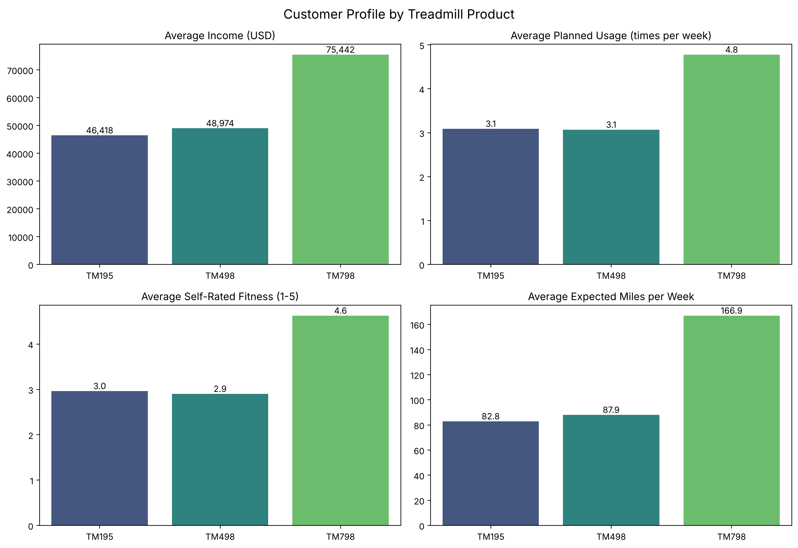
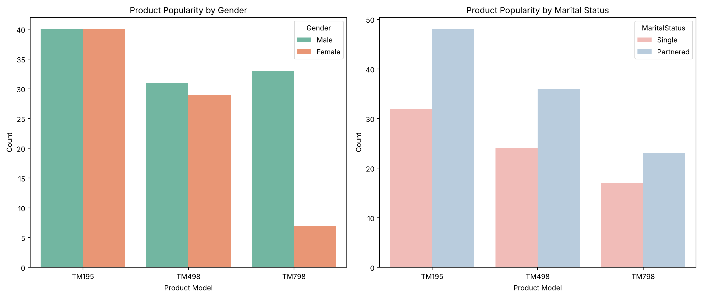
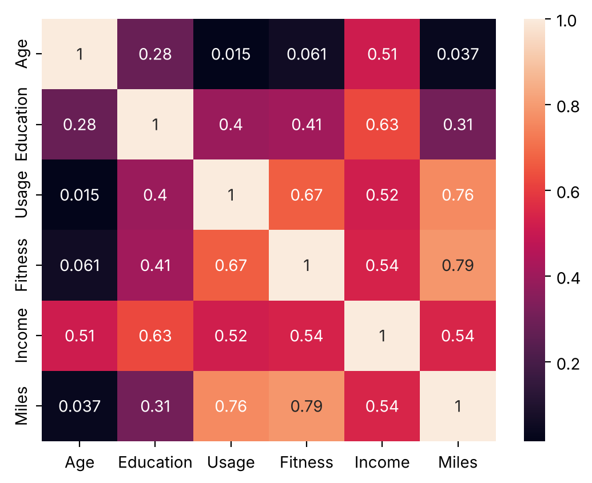

# CardioGood Fitness: Customer Profiling by Treadmill Product

> Descriptive and statistical analysis of 180 treadmill buyers to build a data-backed customer profile for each CardioGood Fitness product line (TM195, TM498, TM798).

[](https://colab.research.google.com/github/Bilal-Butt/CardioGood-Fitness-Data-Analysis/blob/main/notebooks/cardiogood_fitness_customer_profiling.ipynb)


---

## Business problem

The market research team at AdRight wants to know whether the three CardioGood Fitness treadmills attract different kinds of customers, and what the typical buyer of each one looks like. The data covers customers who bought a treadmill at a CardioGood Fitness retail store over a three-month period.

**Objective:** perform descriptive analysis to create a customer profile for each product line, and test whether the differences between products are statistically real.

## Dataset

180 customers, 9 columns, no missing values or duplicates (`data/CardioGoodFitness.csv`).

| Column | Type | Description |
|---|---|---|
| `Product` | categorical | Treadmill purchased: TM195, TM498 or TM798 |
| `Gender` | categorical | Male or Female |
| `Age` | numeric | Age in years |
| `Education` | numeric | Years of education |
| `MaritalStatus` | categorical | Single or Partnered |
| `Income` | numeric | Annual household income (USD) |
| `Usage` | numeric | Average times per week the customer plans to use the treadmill |
| `Fitness` | ordinal | Self-rated fitness, 1 (poor) to 5 (excellent) |
| `Miles` | numeric | Average miles per week the customer expects to walk or run |

## Approach

1. **Data quality and structure:** types, missing values, duplicates.
2. **Univariate analysis:** distributions of every variable.
3. **Bivariate analysis:** product vs. gender and marital status (crosstabs, pivot tables, count plots); age by product and gender.
4. **Correlation analysis:** heatmap, covariance and pairplot.
5. **Customer profiles:** summary table per product, tested with chi-square, one-way ANOVA and Tukey HSD (alpha = 0.05).
6. **Regression:** `Miles ~ Usage + Fitness`, evaluated in-sample and with 5-fold cross-validation.
7. **Recommendations and limitations.**

## Key findings

| | **TM195** | **TM498** | **TM798** |
|---|---|---|---|
| Customers | 80 (44%) | 60 (33%) | 40 (22%) |
| Profile | Casual, entry-level | Casual, mid-range | Serious, high-performance |
| Average age | 28.6 | 28.9 | 29.1 |
| Female share | 50% | 48% | **18%** |
| Education (years) | 15.0 | 15.1 | **17.3** |
| Average income | $46.4k | $49.0k | **$75.4k** |
| Planned usage per week | 3.1 | 3.1 | **4.8** |
| Self-rated fitness (1-5) | 3.0 | 2.9 | **4.6** |
| Expected miles per week | 82.8 | 87.9 | **166.9** |

1. **TM798 buyers are a distinct, high-end segment.** They earn more, are better educated, rate their fitness higher, plan to train more often and expect about twice the weekly miles of other buyers (all differences p < 0.001). All 23 customers earning above $70k bought a TM798.
2. **TM195 and TM498 buyers are statistically indistinguishable** on income, usage, fitness and miles (pairwise p between 0.41 and 0.99).
3. **TM798 skews male:** 33 of 40 buyers are men, versus an even split for the other two products (chi-square = 12.9, p = 0.002).
4. **Marital status and age do not matter for product choice.** About 60% of buyers of every product are partnered (p = 0.96), and mean age is about 29 for all three (p = 0.91).
5. **Miles is driven by usage and fitness.** `Miles ≈ -56.7 + 20.2 × Usage + 27.2 × Fitness` with R² = 0.72 in-sample, falling to about 0.61 on held-out folds because the sample is small.

<p align="center">
  <br>
  <em>TM798 stands apart on income, planned usage, fitness and expected miles.</em>
</p>

<p align="center">
  <br>
  <em>TM798 is mostly bought by men; marital status does not differ across products.</em>
</p>

<p align="center">
  <br>
  <em>Miles is strongly related to Fitness (0.79) and Usage (0.76); Age is nearly unrelated to usage.</em>
</p>

## Recommendations

1. **Position the TM798 as the premium, performance product** for higher-income (about $75k+), highly fit customers who plan to train around five times a week.
2. **Investigate the gender gap on TM798.** Only 18% of its buyers are women. The data cannot explain why, so test with targeted campaigns and surveys.
3. **Treat TM195 and TM498 as one casual segment** and make the difference between them clear through features or price, or consider simplifying the line-up. (No price or feature data is available, so this needs testing.)
4. **Do not segment by age or marital status.** Neither separates the products.
5. **Guide buyers at the point of sale** with two questions: planned weekly usage and fitness level.
6. **Collect richer data:** non-buyers, price paid, satisfaction and repeat purchases.

Full detail is in [`docs/findings_and_recommendations.md`](docs/findings_and_recommendations.md).

## Limitations

- Small sample (180 customers, three months). Some segments are tiny; for example only 7 women bought a TM798.
- Buyers only, so the profiles describe who bought each product, not what drives a purchase.
- Usage, Miles and Fitness are self-reported expectations, not measured behaviour.
- Income, Education, Fitness and Usage are correlated, so their effects on product choice overlap.
- Results are associations, not causal effects.

## Repository structure

```
CardioGood-Fitness-Data-Analysis/
├── notebooks/
│   └── cardiogood_fitness_customer_profiling.ipynb   # full analysis (runs top to bottom)
├── data/
│   └── CardioGoodFitness.csv
├── docs/
│   ├── findings_and_recommendations.md   # curated findings, tests and recommendations
│   └── notebook_text_full.md             # all narrative text from the notebook
├── images/                                # charts used in this README
├── requirements.txt
├── LICENSE
└── README.md
```

## How to run

**Google Colab (easiest):** click the *Open in Colab* badge above. The notebook downloads the data from this repository automatically.

**Locally:**

```bash
git clone https://github.com/Bilal-Butt/CardioGood-Fitness-Data-Analysis.git
cd CardioGood-Fitness-Data-Analysis
python -m venv .venv && source .venv/bin/activate   # Windows: .venv\Scripts\activate
pip install -r requirements.txt
jupyter notebook notebooks/cardiogood_fitness_customer_profiling.ipynb
```

## Tech stack

Python, pandas, NumPy, SciPy, statsmodels, scikit-learn, Matplotlib, Seaborn, Jupyter / Google Colab.

## Author

**Muhammad Bilal Butt**, Data Analyst.
[GitHub](https://github.com/Bilal-Butt) | [LinkedIn](https://www.linkedin.com/in/muhammad-bilal-butt-03a476232)

Released under the [MIT License](LICENSE).
